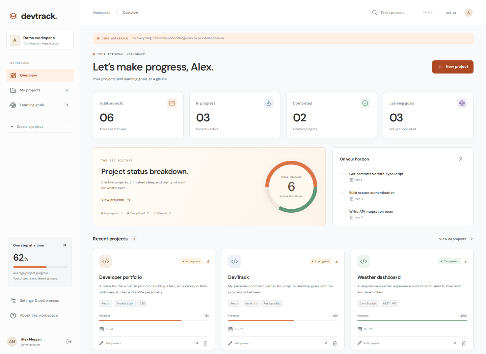
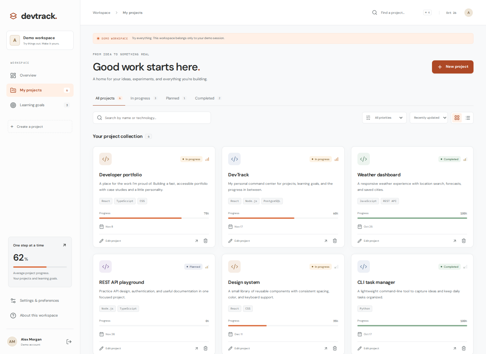

# DevTrack

**A personal workspace for development projects and learning goals.**

I built DevTrack to keep project work and the skills behind it in one place: what I’m building, what needs attention, and what I’m learning next. The result is a full-stack application with a React interface, a Node API, and PostgreSQL-backed accounts and data.



**Try it:** start the app below and select **Try the demo**. No signup is required; each visitor gets a separate, editable sample workspace. **View source** opens a source browser bundled with the running app, generated from this exact checkout. It does not depend on an unpublished GitHub repository.

**Live deployment:** no public host or URL is configured in this release. Local checks do not establish that a live website is available. See [deployment](docs/DEPLOYMENT.md) for the remaining host setup and verification.

For a guided code walkthrough, see [Reading the DevTrack code](docs/CODE_GUIDE.md) and [comment coverage/checks](docs/COMMENT_REVIEW.md).

## What I built

- Projects with status, priority, progress, dates, technology tags, repository/live links, search, filtering, sorting, and grid/list views.
- Learning goals that can connect to a project, be completed/reopened, or remain independent when a project is deleted.
- A dashboard with real totals, a clearly labeled **project status breakdown**, recent work, and upcoming goals.
- Account creation, sign-in/out, profile editing, password changes, optional email recovery, and workspace JSON export.
- A public landing page with actual app screenshots, an isolated demo, sharing previews, and a built-in source browser.
- Light/dark/system themes, keyboard-accessible dialogs and navigation, mobile layouts, and an error boundary with reload recovery.



## Engineering choices

**React + TypeScript + Vite** on the frontend; a **Node HTTP API + TypeScript** on the backend; **PostgreSQL** for production. Local development can use PGlite, an embedded PostgreSQL engine persisted in `backend/data/devtrack`. No framework replacement or paid service is needed to run the demo locally.

The server derives account ownership from its session, rather than accepting a user ID from the browser. Passwords use salted scrypt hashes. Sessions use HttpOnly cookies and hashed server-side tokens; writes require CSRF tokens and a matching origin. Password changes are account-bound, survive page navigation, and synchronize the replacement token before later writes. A reply from an exited account cannot update its replacement.

Docker separates owner-only schema/permission setup from the app’s restricted, data-only database login. Production startup rejects privileged database roles. Tests cover API workflows, authorization, password races, browser interactions, accessibility, data-preserving upgrades, and packaging. [GitHub Actions](.github/workflows/ci.yml) defines checks for browsers, Docker, and PostgreSQL 17/18; a workflow definition is not a claim that an external CI run passed.

## Run locally

Install **Node.js 24 LTS**. Open a terminal in the extracted `DevTrack` folder:

```bash
npm run setup
npm run dev
```

Open **http://localhost:4173**. Select **Try the demo** or create your own account. Swagger is **http://localhost:4173/api-docs/**. Stop the development server with **Ctrl+C**. On Windows, `Start_DevTrack.cmd` runs this quickstart and opens the browser.

The launcher chooses a free API port, configures the Vite proxy/origin, and creates the source browser. There are no shared demo credentials. Each environment uses its own session cookie namespace.

For the built single-process version:

```bash
npm run build
npm start
```

Open **http://localhost:3000**; Swagger is **http://localhost:3000/api-docs/**. If you have a `backend/.env`, set its `APP_ORIGIN=http://localhost:3000` for this mode. The clean ZIP contains source and locked manifests; setup/build recreate the generated output.

## Updating without losing saved work

Back up your existing installation/database first. Stop the app and copy the updated files into the existing folder. **Keep `backend/data/`, `backend/.env`, root `.env`, and the existing Docker volume.** Run `npm run setup` before restarting Node. Do not copy a database directory from a running app or switch to a new extraction and expect its database to contain your accounts.

Docker’s PostgreSQL database and Node’s embedded database are separate. This release preserves either existing store in place; it does not copy accounts between them.

For an existing Docker installation, keep **DB_PASSWORD unchanged**. The Windows Docker launcher adds a new random **APP_DB_PASSWORD** if missing, without replacing the old settings. For a manual setup, add `APP_DB_PASSWORD` (a separate random value, at least 24 characters) to your private root `.env`; `APP_DB_USER` defaults to `devtrack_app`. Then run:

```bash
docker compose up -d --build --wait
```

The repeatable `database-setup` job runs with owner credentials, applies the schema and restricted-role permissions in one transaction, and leaves saved accounts, password hashes, projects, and goals in place. The app starts only after setup succeeds and receives only the restricted login. This runs on **existing volumes as well as fresh databases**; it does not depend on an initialization script. Use `docker compose down` to stop while retaining data. Never add `--volumes` to a normal stop command.

## Docker and public hosting

On Windows, open Docker Desktop and run `Start_DevTrack_Docker.cmd`. For manual startup, copy `.env.example` to `.env`, choose two separate random database passwords, and run the Compose command above. Open **http://localhost:3000**. The database has no published port; the app binds to loopback for local use or an HTTPS reverse proxy.

For public hosting, use a host that supports a persistent Node process or Docker **and PostgreSQL**, configure a real HTTPS origin, provision the restricted login with owner access, and supply runtime/SMTP secrets through the host. [Deployment guide](docs/DEPLOYMENT.md) includes exact production commands, owner recovery, and checks. This Node/PostgreSQL application cannot be deployed unchanged as a static-only site or Cloudflare Worker.

## Verification

```bash
npm run check
npm run test:ui:install
npm run test:ui
npm audit
npm --prefix backend audit
npm --prefix frontend audit
```

`check` runs isolation/launcher/packaging tests, API/client/embedded upgrade tests, frontend lint, both builds, and production safety checks. Browser tests start an isolated in-memory database. Real Chromium tests cover desktop/mobile flows, the landing page/demo, source links, sharing metadata, error recovery, Swagger, and password navigation/account races.

With Docker running, use `npm run verify:docker`. It builds and tests a fresh database, container replacement, and an older owner-login installation upgraded with its populated volume, then tests production settings. For a disposable PostgreSQL service, set `DEVTRACK_POSTGRES_TEST_URL` for an administrative test login and run `npm run build` followed by `npm run test:postgres`. The runner creates/removes only its own random database and test role. These external checks must actually run before treating Docker/PostgreSQL deployment as verified.

PGlite tests execute schema/table permissions and preserve saved fixtures, but cannot apply database-level ACL changes. The external PostgreSQL and Docker suites cover those grants, login credentials, production API CRUD, and actual persisted volumes. See [this release’s results](docs/RELEASE-2.2.0.md) for what was and was not run.

## Useful commands

| Command | Purpose |
| --- | --- |
| `npm run setup` | Install the locked root, backend, and frontend dependencies. |
| `npm run dev` | Start the local website, API, and proxy. |
| `npm run build` / `npm start` | Build, then serve the website and API together. |
| `npm run db:migrate` | Apply schema using an owner login; local development only or a deliberate owner release job. |
| `npm run db:provision` | External PostgreSQL owner job: schema plus restricted login; requires `APP_DB_USER` / `APP_DB_PASSWORD`. |
| `npm run account:reset -- your_username` | Installation-owner recovery with hidden terminal password prompts. |
| `npm run verify:docker` | Disposable fresh/legacy-volume upgrade and production container checks. |
| `npm run test:postgres` | Disposable external PostgreSQL permissions, upgrade, and concurrency checks. |
| `node scripts/capture-portfolio.mjs` | Re-capture portfolio assets from a built app using isolated sample data and Chromium. |
| `npm run package` | Build and create a clean source ZIP in `release/`. |

Passwords cannot be read back. For forgotten local credentials, stop your existing installation and run the account reset command there; projects and goals remain intact. For Docker, see [owner recovery](docs/DEPLOYMENT.md#owner-assisted-password-recovery).

## Cookies, storage, and privacy

The essential sign-in cookie is HttpOnly, SameSite=Lax, and Secure with the `__Host-` prefix in production. Browser localStorage holds only `devtrack-theme` and `devtrack-view`. sessionStorage is intentionally unused. Passwords, account records, and session tokens are not stored in localStorage. There are no application analytics, advertising cookies, or tracking scripts.

Demo accounts are explicitly marked and isolated. Cleanup removes only eligible expired demo accounts, never personal accounts inferred from their names or emails. Do not store sensitive information in a temporary demo. Email recovery requires your SMTP provider; otherwise the app offers owner-assisted terminal recovery.

[API reference](docs/API.md) · [OpenAPI](docs/openapi.json) · [Deployment](docs/DEPLOYMENT.md) · [Retest guide](docs/RETEST.md)
